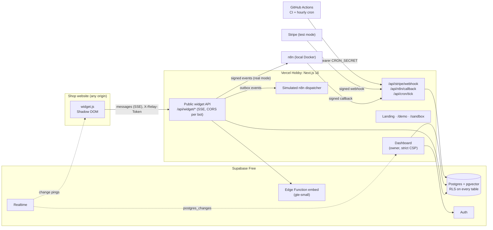

# Relay AI

> **Answers first. Humans when it matters.** · _Prvo odgovor. Čovek kad je bitno._

Relay AI is an embeddable support chatbot for small web shops, in English and Serbian. The
owner writes their FAQ and pastes one `<script>` line on their site. Visitors get an instant
answer that cites the FAQ it came from. When the bot doesn't know, or the visitor asks for a
person, the chat moves to the owner's live inbox, and the reply reaches the open widget within
a second. The bot can also run guided actions (look up an order, open a ticket) through n8n.
Everything runs on free tiers and costs nothing to operate.

**Live:** [relay-ai-teal.vercel.app](https://relay-ai-teal.vercel.app) ·
[demo store](https://relay-ai-teal.vercel.app/demo) ·
[sandbox dashboard](https://relay-ai-teal.vercel.app/sandbox) (no sign-up, sample data, deleted
after 7 days)

<!--
  Screenshots and recordings go in docs/media/. Replace each placeholder below with the image:
  
-->

| What                                          | Media                                                                            |
| --------------------------------------------- | -------------------------------------------------------------------------------- |
| Landing page with the live widget             | _placeholder: `docs/media/landing.png`_                                          |
| Visitor and owner chatting live (two windows) | _placeholder: `docs/media/handoff.gif`_                                          |
| Order lookup action in the demo store         | _placeholder: `docs/media/order-lookup.gif`_                                     |
| Analytics and unknown questions               | _placeholder: `docs/media/analytics.png`_                                        |
| Real n8n workflows running locally            | _placeholder: `docs/media/n8n.mp4` (see [below](#n8n-locally-and-recording-it))_ |

## Contents

- [What it does](#what-it-does)
- [Architecture](#architecture)
- [The $0 stack](#the-0-stack)
- [Sample mode and Live mode](#sample-mode-and-live-mode)
- [Local setup](#local-setup)
- [Tests and quality gates](#tests-and-quality-gates)
- [Deploying your own copy](#deploying-your-own-copy)
- [n8n locally, and recording it](#n8n-locally-and-recording-it)
- [What is stored, and for how long](#what-is-stored-and-for-how-long)
- [Security](#security)
- [Trade-offs](#trade-offs)
- [Reference](#reference): widget, public API, retrieval, scripts, repository layout

## What it does

- **Knowledge:** FAQ entries in English and Serbian, typed or pasted as `Q:`/`A:` blocks. Each
  question is embedded (Supabase's built-in `gte-small`) and found with pgvector plus Postgres
  full-text search. **Test your bot** shows the matches, their scores and the reply.
- **Widget:** a 13 KB (gzipped) vanilla TypeScript bundle in a Shadow DOM. It answers only on
  the websites the owner allows, streams replies, shows sources, and resumes after a refresh.
- **Handoff and inbox:** "Talk to a person", or two unknown answers in a row, moves the chat to
  the owner's inbox (Supabase Realtime, 5-second polling when sockets are blocked). The visitor
  can leave an email; replies are emailed through n8n if they've left the page.
- **Actions:** order lookup and ticket creation, each confirmed by the visitor first, run by
  n8n workflows. In the public demo a simulated dispatcher plays n8n's part, labelled as such.
- **Analytics:** conversations per day, answered by the bot vs handed off, first-response time,
  ratings, and unknown questions with the owner's reply as a draft FAQ answer.
- **Plans:** Free (1 bot, 50 conversations a month) and Pro (3 bots, 1,000), billed with Stripe
  in **test mode only**. No real card is ever charged.

## Architecture



- **Tenancy:** every owner table has row-level security. The public widget endpoints use the
  service-role client but always scope by the bot (from its public key) and by the
  conversation token, never by an id the browser sent.
- **Quotas and limits live in SQL:** `start_conversation` checks and counts the monthly quota
  atomically, `check_rate_limit` is an atomic upsert, so parallel requests can't overshoot.
- **Outbox:** events for n8n (escalation emails, reply emails, actions) are written to
  `n8n_outbox` in the same request and delivered with retries by the cron tick.
- **Realtime carries no content:** the widget's channel only says "something changed"; the
  widget then fetches through its token-protected API.

## The $0 stack

| Service                      | Free tier used for                                                |
| ---------------------------- | ----------------------------------------------------------------- |
| Vercel Hobby                 | The Next.js app (`*.vercel.app`, no custom domain)                |
| Supabase Free                | Postgres, pgvector, Auth, Realtime, Storage, the `embed` function |
| Supabase `gte-small`         | Embeddings inside an Edge Function: no external API, no key       |
| Stripe test mode             | Checkout, Customer Portal, webhooks; live keys are refused        |
| Cloudflare Turnstile         | Bot check before a sandbox is created                             |
| GitHub Actions (public repo) | CI (gitleaks, tests, e2e) and the hourly cron tick                |
| n8n self-hosted (Docker)     | Real workflows, on your own machine only                          |

Next.js 16 (App Router, TypeScript strict) · Tailwind CSS 4 · shadcn/ui · next-intl · motion ·
Recharts · zod · Vitest · Playwright · esbuild (widget).

## Sample mode and Live mode

**Sample mode is what runs, everywhere.** The bot answers with the matched FAQ's text, word for
word, streamed like any reply and labelled "Sample". No language model is called, so answers
can't be invented, and the project needs no API key or credits.

**Live mode** (Claude writing replies from the matched FAQs, with tool use for actions) was
planned as an optional upgrade and is **not built**: it would bill per token, and this project
must cost nothing to run. The engine keeps the switch (`selectMode` checks for a key and a daily
cap) and records `live_not_included` as the reason on every bot message. Everything else
(answers, guided actions, handoff, inbox, analytics) works fully in Sample mode. See
[`docs/DECISIONS.md`](docs/DECISIONS.md#phase-10-live-mode-claude-skipped).

## Local setup

Requirements: Node 24 (`.nvmrc`), pnpm 12, Docker Desktop (for the local Supabase stack).

1. `git clone https://github.com/veljkovasojevic03/relay-ai.git && cd relay-ai`
2. `pnpm install`
3. `cp .env.example .env.local`. Every value is optional; the comments say what each one does.
4. `pnpm db:start:embed`: a local Supabase stack with all migrations and the `embed` function
   (first start pulls Docker images; the first embedding downloads the model, ~130 MB).
5. Copy the printed `API_URL`, `PUBLISHABLE_KEY` and `SECRET_KEY` into `.env.local` as
   `NEXT_PUBLIC_SUPABASE_URL`, `NEXT_PUBLIC_SUPABASE_ANON_KEY` and `SUPABASE_SERVICE_ROLE_KEY`.
6. `pnpm demo:seed`: creates the demo store's bot with 50 indexed FAQs.
7. `pnpm dev`, then open http://localhost:3000 (English) or http://localhost:3000/sr.
8. Sign up at `/signup`; the confirmation email lands in Mailpit at http://127.0.0.1:54324.
9. Create a bot, add FAQs, try them under **Test your bot**, and open `/demo` for the widget.
10. Optional: [run n8n](#n8n-locally-and-recording-it), add Stripe test keys
    ([billing](#deploying-your-own-copy)), or set Cloudflare's always-pass Turnstile keys
    (listed in `.env.example`).

Without Supabase the app still starts: the public pages render, sign-in says it isn't set up,
the widget API answers `not_configured`, and `GET /api/health` says `degraded`. `pnpm db:stop` stops the stack. `pnpm db:start` (without
`:embed`) is lighter but leaves new FAQs "Not indexed".

## Tests and quality gates

| Command               | What it checks                                                                                                          |
| --------------------- | ----------------------------------------------------------------------------------------------------------------------- |
| `pnpm lint`           | ESLint                                                                                                                  |
| `pnpm typecheck`      | Route types, the app and the widget (`tsc --noEmit`)                                                                    |
| `pnpm test`           | Unit tests (Vitest): engine, guards, signing, CORS, CSP, i18n, billing                                                  |
| `pnpm test:db`        | Against the local stack: RLS isolation, column grants, quota and rate-limit races, retrieval, purge, Stripe idempotency |
| `pnpm e2e:local`      | Production build + Playwright against the local stack (below)                                                           |
| `pnpm eval:retrieval` | Retrieval accuracy on the golden set → `docs/RETRIEVAL_REPORT.md`                                                       |
| `pnpm db:lint`        | SQL lint (plpgsql_check)                                                                                                |
| `pnpm format:check`   | Prettier                                                                                                                |

The Playwright suite covers the main journeys: sign-up with email confirmation, sign-in and
password reset; creating a bot and embedding its widget on a **foreign origin**; the widget's
Shadow DOM isolation and keyboard use; a two-window live handoff, including the polling
fallback with the socket killed; confirmed actions; analytics; the demo store; the sandbox;
billing; and the landing page. `e2e/hardening.spec.ts` runs **axe** (WCAG 2.2 A/AA) on the
public pages, a populated dashboard and the open widget, checks the skip link and keyboard
use, and loads every dashboard page under the strict CSP, failing on any violation.

**CI** (`.github/workflows/ci.yml`, every push and PR): gitleaks over the full history, then
`pnpm audit --prod`, format, lint, typecheck and unit tests; then a disposable local Supabase
stack for the SQL lint, the RLS/`search_path` catalog check, a check that generated DB types
are current, the DB tests, and finally
the build and the whole e2e suite. The widget build fails above 30 KB gzipped.

## Deploying your own copy

1. **Supabase:** create a Free project, then `pnpm exec supabase login`,
   `pnpm exec supabase link --project-ref <ref>`, `pnpm exec supabase db push` and
   `pnpm exec supabase functions deploy embed`. In the dashboard: turn on **anonymous
   sign-ins** (for the sandbox), set the **Site URL** to your app URL and add
   `<app URL>/api/auth/callback` to the redirect URLs. Google sign-in is optional
   (Authentication → Providers).
2. **Vercel:** import the repo. Set the variables from `.env.example`: `NEXT_PUBLIC_APP_URL`,
   the three Supabase values (the **secret** key `sb_secret_…` as `SUPABASE_SERVICE_ROLE_KEY`),
   `IP_HASH_SALT`, `CRON_SECRET`, and optionally Turnstile and Stripe. Leave the n8n variables
   empty: the deployed app uses the simulated dispatcher.
3. **Demo data:** with `.env.local` pointing at the cloud project, `pnpm demo:seed` once.
4. **Stripe (test mode):** a product "Relay AI Pro" with a $19 monthly price
   (`STRIPE_PRICE_PRO`), and a webhook endpoint `<app URL>/api/stripe/webhook` for
   `checkout.session.completed` and `customer.subscription.created`, `.updated`, `.deleted`
   (`STRIPE_WEBHOOK_SECRET`). Locally: `stripe listen --forward-to localhost:3000/api/stripe/webhook`.
5. **Cron:** repository secrets `APP_URL` and `CRON_SECRET` enable the hourly
   `POST /api/cron/tick` (outbox delivery, purging, and keeping the free database awake).

## n8n locally, and recording it

n8n is never hosted publicly. On your machine it runs the real workflows: escalation and reply
emails, order lookup and ticket creation. The full guide is [`n8n/README.md`](n8n/README.md);
the contract (payloads, signing, callbacks) is [`docs/N8N_CONTRACT.md`](docs/N8N_CONTRACT.md).

```bash
cd n8n && cp .env.example .env    # set N8N_ENCRYPTION_KEY and N8N_SHARED_SECRET
docker compose up -d               # http://localhost:5678, create the owner account
```

Import the workflows from `n8n/workflows/` (instructions in `n8n/README.md`), then in the
app's `.env.local` set `N8N_MODE=real`, `N8N_WEBHOOK_BASE=http://localhost:5678/webhook` and
the same `N8N_SHARED_SECRET`, and restart `pnpm dev`. `pnpm n8n:send <event>` fires signed
test events (including bad signatures and stale timestamps, which must be rejected), and
`pnpm n8n:verify` checks the app's own callback rules.

**Recording the demo** (for the placeholder above): with n8n's **Executions** list in one
window and `/demo` in another, record the screen while you (1) track order `KR-10482` with
`marko@example.com`, (2) ask for a person and leave an email, and (3) reply from the inbox
after closing the demo tab. Each step appears as a green execution, and the escalation and
reply emails arrive in the inbox you configured. Save it as `docs/media/n8n.mp4` (or a GIF).

## What is stored, and for how long

| Data                                 | Stored                                                                              | Kept until                                                                        |
| ------------------------------------ | ----------------------------------------------------------------------------------- | --------------------------------------------------------------------------------- |
| Owner account                        | Email, name, language, plan; Stripe ids if they subscribed                          | The account is deleted (ask the operator; the app has no self-serve deletion yet) |
| Bots and FAQs                        | Settings, logo, FAQ text and its embedding                                          | The owner deletes them                                                            |
| Conversations on an owner's bot      | Messages, language, rating, timings                                                 | The owner deletes the conversation (Inbox → Delete)                               |
| Visitor email                        | Only if the visitor types it in the widget                                          | Deleted with the conversation                                                     |
| Visitor IP                           | Never stored. A salted SHA-256 hash, for rate limits only                           | With the conversation; rate-limit windows after 2 days                            |
| Conversation token                   | SHA-256 hash on the server; the visitor's browser keeps the token in `localStorage` | With the conversation                                                             |
| Demo-store and sandbox conversations | As above                                                                            | **30 days**                                                                       |
| Sandbox accounts                     | Everything a sandbox contains                                                       | **7 days**, or right away with "End sandbox"                                      |
| n8n outbox, signed-callback ids      | Event payloads (minimal), delivery status                                           | 30 days once delivered or failed; replay ids 1 day                                |

Purging runs in the hourly cron tick (`purge_expired_data()`). Server logs are structured JSON
without message content, emails or secrets.

## Security

- **Tenant isolation:** RLS on every table (CI checks the catalog with
  `scripts/db-hardening.sql`, and DB tests try to cross tenants), column-level
  grants so owners can't change their plan, Stripe or sandbox columns, `SECURITY DEFINER`
  functions with a pinned `search_path`.
- **Widget endpoints:** CORS only for the bot's allowed websites (exact origin echoed,
  `Vary: Origin`), a 128-bit conversation token stored only as a hash and compared in constant
  time, per-conversation caps (20 messages, 500 characters), per-IP-hash, per-bot and daily
  rate limits.
- **Content:** visitor, owner and bot text is always rendered as text (React escaping in the
  dashboard, `textContent` in the widget; no `innerHTML` anywhere). Actions need a visitor
  confirmation, inputs are validated with zod, and an order lookup needs the matching email.
- **CSP:** the dashboard and sign-in pages get a per-request nonce policy (`script-src
'nonce-…' 'strict-dynamic'`, no `unsafe-inline` scripts, connections only to the app and the
  Supabase project, `frame-ancestors 'none'`). Every response has `nosniff`, a referrer policy,
  `X-Frame-Options` and a restrictive `Permissions-Policy`.
- **Signed integrations:** n8n events and callbacks carry an HMAC-SHA256 signature over
  timestamp and event id, with a 5-minute window and replay protection; the Stripe webhook is
  verified on the raw body and processed idempotently.
- **Secrets:** only in `.env.local` (git-ignored) and in Vercel/GitHub settings; the
  service-role client is `server-only`; gitleaks scans the history in CI; the app refuses to
  start with a live Stripe key.
- **Accessibility:** keyboard navigable with visible focus and a skip link, labelled controls,
  AA contrast, `prefers-reduced-motion` respected; checked by axe in CI.

## Trade-offs

- **The origin allowlist is not abuse protection.** Browsers send an honest `Origin`, so it
  stops casual embedding on other sites, but any script outside a browser can claim any origin.
  The real limits are the rate limits, per-conversation caps and monthly quotas.
- **n8n signatures don't cover the body.** The HMAC signs `timestamp.eventId`, which proves
  who sent the request and that it's fresh; the payload's integrity relies on TLS. Signing the
  raw body would be stronger but is awkward to reproduce inside n8n's nodes.
- **Free Supabase pauses after 7 idle days.** The hourly cron tick keeps it awake, but GitHub
  can delay or skip scheduled runs. If the database is waking up, `/demo` says so and offers a
  retry.
- **Vercel Hobby is for non-commercial use**, so billing stays in Stripe test mode, labelled on
  every billing screen. Streaming routes are capped at 30 seconds, well under Hobby's limit,
  and replies are short.
- **The dashboard renders per request.** A nonce CSP can't reach scripts in a prerendered
  shell, so the dashboard and sign-in pages skip the static shell; the marketing pages stay
  static and cached. Styles still allow inline `style` attributes (charts, the widget preview).
- **Serbian retrieval is weaker.** `gte-small` is an English model. Serbian uses hybrid search
  (vector + full text) and stricter thresholds, so it answers fewer questions on its own and
  offers suggestions instead. Both languages missed the spec's top-1 targets by 1–2 points; the
  real numbers are in [`docs/RETRIEVAL_REPORT.md`](docs/RETRIEVAL_REPORT.md).
- **No self-serve account deletion** for owners yet; conversations can be deleted one by one.

## Reference

### The widget

Paste the snippet from the bot's settings page before `</body>`:

```html
<script src="https://<your-app>/widget.js" data-bot="<public key>" async></script>
```

Add `data-lang="sr"` (or `en`) to force a language; otherwise the page's `<html lang>` and then
the browser decide. On websites not listed under the bot's **Allowed websites** the widget stays
hidden and logs a console warning. Host pages can call `window.RelayAI.ask(text)` to open the
chat with a question. `pnpm build` and `pnpm dev` build the widget first; `pnpm widget:watch`
rebuilds it while you work on `widget/src`.

### Public widget API

CORS only for the bot's allowed websites. The first message starts a conversation and returns
a token once, in the `meta` event; send it back as `X-Relay-Token` on later calls.

| Endpoint                            | What it does                                                  |
| ----------------------------------- | ------------------------------------------------------------- |
| `GET /api/widget/config?bot=`       | Public bot settings and whether new chats can start           |
| `POST /api/widget/message`          | `{bot, text, locale}` → the bot's reply as Server-Sent Events |
| `POST /api/widget/confirm`          | `{bot, actionRunId, decision}`: confirm or cancel an action   |
| `GET /api/widget/poll?bot=&since=`  | New human/system messages (fallback for Realtime)             |
| `GET /api/widget/conversation?bot=` | The whole conversation, to resume after a refresh             |
| `POST /api/widget/rate`             | `{bot, rating: "up" \| "down"}`                               |
| `POST /api/widget/handoff`          | `{bot, email?}`: "Talk to a person", or the email afterwards  |
| `POST /api/widget/end`              | `{bot}`: the visitor closes the chat                          |

```bash
curl -N -X POST http://localhost:3000/api/widget/message \
  -H "Content-Type: application/json" \
  -d '{"bot":"<public key>","text":"How long does delivery take?"}'
```

```text
event: meta
data: {"token":"…","mode":"sample","language":"en"}

event: delta
data: {"text":"Orders placed by"}
…
event: sources
data: {"faqs":[{"id":"…","question":"How long does delivery take?"}]}

event: done
data: {"outcome":"answered","offerHuman":false,"suggestions":[],"remainingMessages":19}
```

Errors are JSON with a status code, for example `{"error":"origin_not_allowed"}` (403) or
`{"error":"message_cap_reached"}` (429). `GET /api/health` runs a real database query.

### Knowledge and retrieval

The `embed` Edge Function authenticates callers with the project's **secret key**
(`sb_secret_…`), so `SUPABASE_SERVICE_ROLE_KEY` must hold that key, not the legacy service-role
JWT. Thresholds, the hybrid setting per language and how they were chosen are in
[`docs/RETRIEVAL_REPORT.md`](docs/RETRIEVAL_REPORT.md); re-run `pnpm eval:retrieval` (local
stack with `:embed`) after changing any of them.

### Scripts

| Command                           | What it does                                               |
| --------------------------------- | ---------------------------------------------------------- |
| `pnpm dev` / `pnpm build`         | Widget + dev server / production build                     |
| `pnpm db:start` / `:embed`        | Local Supabase stack (with the Edge runtime)               |
| `pnpm db:reset` / `pnpm db:types` | Re-create the local DB / regenerate its TypeScript types   |
| `pnpm demo:seed`                  | Create or restore the demo store's bot                     |
| `pnpm demo:seed-analytics <key>`  | 30 days of sample history for a bot (`--clear` removes it) |
| `pnpm demo:mark-bot <key>`        | Let one of your bots look up the demo orders               |
| `pnpm n8n:send` / `n8n:verify`    | Signed test events for n8n / the callback's rules          |
| `pnpm format`                     | Prettier                                                   |

More in [`scripts/README.md`](scripts/README.md).

### Repository layout

| Path        | Contents                                               |
| ----------- | ------------------------------------------------------ |
| `src/`      | Next.js app: pages, API routes, shared libraries       |
| `widget/`   | The embeddable widget (built to `public/widget.js`)    |
| `supabase/` | CLI config, SQL migrations, the `embed` Edge Function  |
| `messages/` | UI copy (`en.json`, `sr.json`)                         |
| `n8n/`      | Local n8n (Docker Compose) and the exported workflows  |
| `eval/`     | Retrieval golden set                                   |
| `scripts/`  | Seeding, evals, signed n8n test events                 |
| `tests/db/` | Database integration tests                             |
| `e2e/`      | Playwright tests                                       |
| `docs/`     | Decisions, style guide, n8n contract, retrieval report |

Design decisions, phase by phase: [`docs/DECISIONS.md`](docs/DECISIONS.md). Design system:
[`docs/STYLE_GUIDE.md`](docs/STYLE_GUIDE.md).
